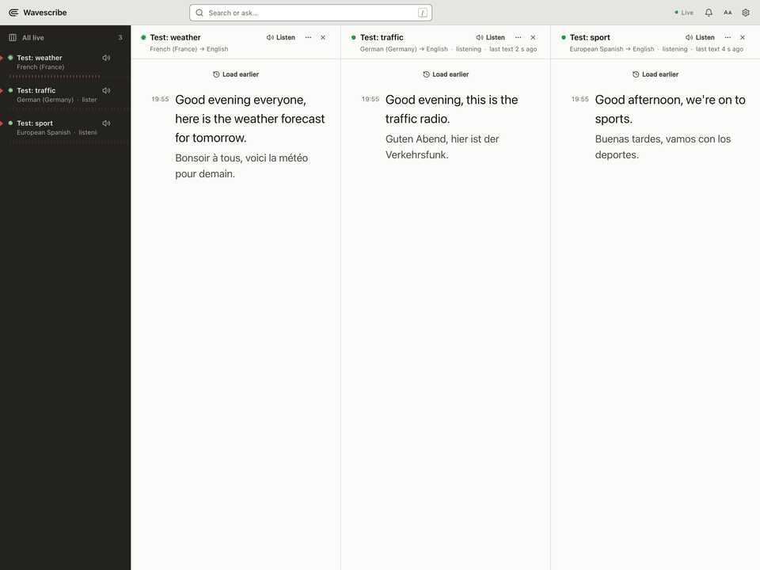

<h1>
  <picture>
    <source media="(prefers-color-scheme: dark)" srcset="assets/lockup-on-dark.svg">
    
  </picture>
</h1>

**Wavescribe listens to the radio for you.** It follows several stations at once, writes down
what is said, translates it into your language, and **alerts you when something you care about
comes up**: a road closure, a strike, a water cut, a wildfire. It works with FM and other radio
through an inexpensive RTL-SDR receiver, and with internet radio. Everything runs on your Mac,
with no cloud and no account.



*Test broadcasts made with text-to-speech, not real stations. The recognition, the translation
and the alert are the app's own output.*

Early alpha, for macOS on Apple Silicon.
**[Getting started](docs/GETTING_STARTED.md)** · [Documentation](#documentation)

**Not a safety system.** Wavescribe can miss an announcement, or raise an alert for something
that wasn't said: reception drops, speech recognition and machine translation make mistakes, and
this is early software. Use it to stay informed, never as your only source where life, health or
property is at stake: follow official warnings and the emergency services.

## What it's for

Radio is live, in one language, one station at a time, and gone once it's said. Wavescribe
writes it down, translates it and keeps it, so it can be read, searched and acted on.

- **Where you don't speak the language.** Read local news and official announcements in your own
  language, and get an alert for what matters to you: a wildfire, a flood warning, a strike, a
  road closure, a power or water cut.
- **Learning a language, or keeping up with home.** Real radio, each sentence next to its
  translation, and any sentence can be played again.
- **Radio you can read.** For deaf and hard-of-hearing people, radio as text, sentence by
  sentence, a few seconds behind the broadcast, on the Mac or on a phone. Speech recognition
  makes mistakes; this is not a certified captioning service.
- **Many stations, one reader.** Journalists, researchers and media monitors follow several
  stations in several languages, search everything that was said, and ask questions that are
  answered with the quoted moments.
- **Out of curiosity.** Plug in a receiver and see what is on the air around you: one scan lists
  the stations it hears, with their names where they send one.
- **Automations.** An alert can call a webhook, so a home-automation system or a chat bot can act
  on it: flash a lamp, post a message.
- **Give your AI agent a radio.** An AI agent can search what was said, ask about it, and wait for
  alerts to act on, through an MCP server or JSON on the command line; experimental, see
  [Agent tools](docs/AGENT_TOOLS.md).
- **One listener, many readers.** One Mac follows the radio and everyone on the same Wi-Fi reads
  along on a phone: a household, a club, a community centre.
- **Off the grid.** On a boat, in a campervan or a cabin: with a receiver it needs no internet.
- **When the power and the networks go down.** Broadcast radio keeps working. During the power
  cut of 28 April 2025 in Spain and Portugal, radio was how people learned what was going on, in
  Spanish and Portuguese only.

## What it does

- **Several stations at once**, from internet streams or from one or more RTL-SDR receivers: FM
  broadcast, and (experimental) walkie-talkie, amateur, marine and aviation channels.
- **Finds stations**: scans a band, names FM stations from their RDS, and turns any frequency
  into a station.
- **Transcribes live** in about 100 languages, and skips the music.
- **Translates** into your language as it is said, and into other languages for alerts or on
  demand.
- **Alerts** from keywords, regular expressions or a plain-language description ("residents are
  told to leave"), and when a station goes silent or an FM station starts a traffic
  announcement, as a notification, a spoken alert in your language, or a webhook.
- **Search and Ask**: everything heard is kept and searchable, and a question is answered with
  the moments it was said.
- **Phones read along** on the same Wi-Fi, read-only.
- **A text feed and webhooks** for other programs ([docs/FEED.md](docs/FEED.md)).
- **Local by design**: every model runs on your Mac, and nothing is sent anywhere you didn't set
  up.

Not yet: Linux, medium wave and shortwave, a packaged Mac app. Ideas and requests are welcome as
[issues](https://github.com/Kaspler/wavescribe/issues).

## Quick start

You need a Mac with Apple Silicon, 16 GB of memory or more, about 10 GB of disk for the models,
and [Homebrew](https://brew.sh). No receiver is needed to try it: start with internet radio.

```sh
git clone https://github.com/Kaspler/wavescribe.git
cd wavescribe
brew install ffmpeg uv librtlsdr        # librtlsdr only for an RTL-SDR receiver
uv sync
uv run wavescribe models fetch          # about 8 GB of models
uv run wavescribe serve --open          # opens the page: pick stations and read along
```

Already have ffmpeg and uv? Any recent version works.

For news stations in eight languages, ready to try:

```sh
uv run wavescribe serve --config config/stations.world.example.toml --open
```

A few more commands:

```sh
uv run wavescribe serve --lan           # phones on the same Wi-Fi read along (read-only, no
                                        # login: only on a network you trust)
uv run wavescribe search "água"         # search everything heard
uv run wavescribe alerts test           # check notifications and the spoken-alert voices
uv run wavescribe radio scan a fm       # find FM stations with receiver `a`
```

[Getting started](docs/GETTING_STARTED.md) goes through stations, alerts, phones and a radio
receiver step by step.

## Hardware

- **None:** internet radio needs only the Mac.
- **Starter:** one RTL-SDR Blog V4 receiver and its antenna (about €40–60): a few FM stations
  that sit close together, station finding, and listening to any frequency.
- **More stations:** three receivers behind one antenna and a splitter (about €150–250).

[docs/HARDWARE.md](docs/HARDWARE.md) says which Mac, what to buy, which antenna and how to
connect it.

## How it works

```
antennas ─► SDR(s) ─► channelizer ─► audio per station
   ─► speech/music gate ─► speech recognition ─► alert rules ─► notify / speak / log / webhooks
                                              └► translation ─► transcript, web page, text feed
```

Internet streams enter at "audio per station". Details are in
[docs/ARCHITECTURE.md](docs/ARCHITECTURE.md).

## Documentation

| | |
|---|---|
| [Getting started](docs/GETTING_STARTED.md) | Install, stations, reading, search and Ask, alerts, phones, radio receivers, troubleshooting |
| [Hardware](docs/HARDWARE.md) | Which Mac, what to buy, antennas, connectors, setup |
| [Radio](docs/RADIO.md) | Finding stations, listening by hand, what's kept of each kind of radio, the law |
| [Feed and outputs](docs/FEED.md) | The text feed, webhooks, remote stations, using Wavescribe from another program |
| [Agent tools](docs/AGENT_TOOLS.md) | Give your AI agent a radio: the MCP server, JSON output and `follow` (experimental) |
| [Models](docs/MODELS.md) | The speech and translation models per language |
| [Licensing](docs/LICENSING.md) | The licence of every library, tool and model |
| [Architecture](docs/ARCHITECTURE.md) | How it works inside, and the decisions behind it |
| [Measurements](docs/MEASUREMENTS.md) | Speed, memory and long-run figures |

## Using it responsibly

**Don't rely on it for safety.** Wavescribe is not an emergency alert system and no substitute
for official warnings: sirens, cell broadcast, civil protection, the emergency services. An alert
may come late, be wrong, or not come at all, and a quiet page doesn't mean nothing is happening.
Transcripts and translations are made by machine: check the original before you act on one.

**You are responsible for using Wavescribe lawfully where you are.** Laws on receiving radio
differ by country and by kind of radio. Broadcast radio is meant for the public; transcripts and
recordings are for your personal use, and broadcasts are copyrighted. Internet streams also come
with their broadcaster's terms of use, which can limit where and how they may be played. Other
radio (aircraft, ships, walkie-talkies) is often protected: in many countries it may be received
but not recorded or passed on. Wavescribe asks before it listens to such radio and keeps little
of it by default; you set what is kept. It only receives: it cannot transmit, and it has no
digital decoder and no decryption.

[The law where you are](docs/RADIO.md#the-law-where-you-are) has the details. This is not legal
advice. Wavescribe is provided "as is", without warranty of any kind (Apache License 2.0,
sections 7 and 8).

## Contributing

Issues and pull requests are welcome: see [CONTRIBUTING.md](CONTRIBUTING.md). Wavescribe is
written with AI coding tools; if you know radio and something in the signal processing, the band
plan or the hardware guide looks wrong, an issue is the best way to say so. To report a security
problem, see [SECURITY.md](SECURITY.md).

## License

Copyright 2026 Vitali Kaspler. Licensed under the [Apache License 2.0](LICENSE).

Models aren't part of Wavescribe and are never shipped with it: you download each one from its
publisher, under its own licence ([docs/LICENSING.md](docs/LICENSING.md)). The built web page
bundles React and Lucide icons; their notices are in
[`src/wavescribe/web/dist/licenses.txt`](src/wavescribe/web/dist/licenses.txt).
